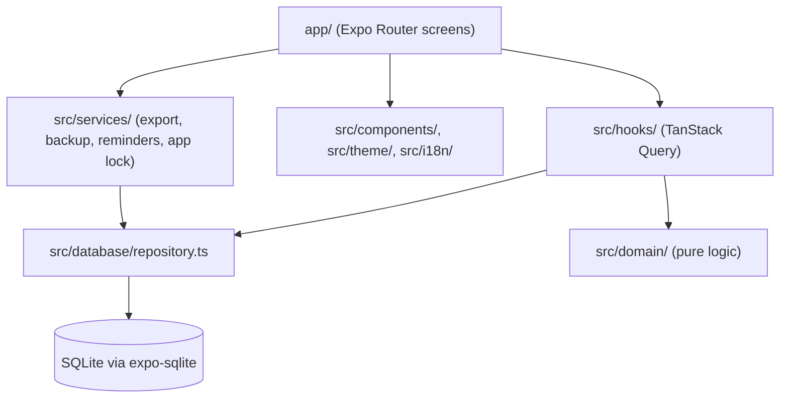

# Architecture

How Cykla is put together and how data flows through it. The README gives the short
version; this document explains what a maintainer needs to change the code safely. Storage
details are in [DATABASE.md](DATABASE.md), the privacy model in [PRIVACY.md](../PRIVACY.md)
and the hardening status in [HARDENING.md](HARDENING.md). Decisions made from now on are
recorded in [`DECISIONS/`](DECISIONS/README.md).

## In one paragraph

Cykla is an offline-first Expo app (Expo SDK 58, React Native, TypeScript, Expo Router) for
iOS, Android and the web. All data stays on the device in a local SQLite database
(`expo-sqlite`, WASM on the web); there is no backend, account or network transmission.
Screens read recorded entries through TanStack Query hooks over a single repository, and
pure functions in `src/domain/` derive cycles, statistics and predictions from them at
runtime. Estimates are never stored.

## Layers and boundaries

| Module                     | Owns                                                                                                           | May depend on                         |
| -------------------------- | -------------------------------------------------------------------------------------------------------------- | ------------------------------------- |
| `app/`                     | Routes: tabs (Today, Calendar, Log, Trends, Settings), day editor, prediction explanation, onboarding, roadmap | everything below                      |
| `src/hooks/`               | Query and mutation hooks (`useCyklaData.ts`), prediction hook, local "today"                                   | `database/`, `domain/`                |
| `src/domain/`              | Dates, cycle derivation, statistics, prediction (`prediction.ts`)                                              | nothing app-specific; no React Native |
| `src/database/`            | Migrations, schema registry, repository, read validation, access serialization                                 | `domain/models.ts`                    |
| `src/services/`            | JSON/CSV export and cleanup, JSON backup restore, local reminders, app-lock lifecycle                          | `database/`, device APIs              |
| `src/i18n/`                | Typed German and English catalogs (`de.ts` defines the shape)                                                  | none                                  |
| `src/config/`              | Branding (single source for name, IDs, colours) and the in-app roadmap                                         | none                                  |
| `src/store/`, `src/theme/` | Transient UI state (Zustand) and light/dark design tokens                                                      | none                                  |

Rules the boundaries enforce:

- Screens never calculate predictions; `src/domain/` does, and it has no React Native
  dependency so it is unit-tested in Node.
- All runtime SQL goes through `src/database/repository.ts`, serialized by
  `withDatabaseAccess` / `withDatabaseTransaction` in `access.ts` (see DATABASE.md).
- Recorded data and calculated estimates stay separate in storage, types and UI.

## Data flow

Saving a day: the day editor (`app/day/[date].tsx`) validates its form with React Hook Form
and Zod and calls `useSaveEntry` (`src/hooks/useCyklaData.ts`). The mutation runs
`saveDailyEntry` in `repository.ts` inside a transaction, then invalidates the entry
queries. `useEntries` re-reads the rows, which `validation.ts` parses (invalid rows are
omitted from reads rather than crashing the app), and `usePrediction`
(`src/hooks/usePrediction.ts`) derives bleeding days and period starts and passes them with
the user's exclusions and typical lengths to `derivePrediction` in
`src/domain/prediction.ts`, which builds cycles, ignores excluded and implausible ones, and
returns an estimate, or none when the history is too sparse or ambiguous.

Start-up: `app/_layout.tsx` mounts `SQLiteProvider`, which awaits `initializeDatabase`
(migrations, WAL, foreign keys) before any consumer renders; it also cleans up temporary
export files, applies the app lock on foregrounding and refreshes the reminder text.

## Invariants and conventions

- Migrations are versioned, transactional and never edited after release; newer schemas
  are rejected without writes.
- Every user-visible string lives in all catalogs under `src/i18n/locales/`; export files
  keep German column names for format stability.
- Predictions are explained in the UI and never presented as certainty or contraception.
- No real health data in fixtures, logs, screenshots or error reports.

## Testing

| Layer                    | Where                                    | Covers                                                                         |
| ------------------------ | ---------------------------------------- | ------------------------------------------------------------------------------ |
| Unit (Vitest)            | `src/**/*.test.ts(x)`                    | Dates, prediction edge cases, statistics, i18n, roadmap config                 |
| SQLite integration       | `src/database/*.test.ts` (`node:sqlite`) | Migrations, repository operations, read validation, interleaving               |
| Services                 | `src/services/*.test.ts`                 | Export serialization and cleanup, backup parsing, app lock, reminders          |
| Bundle smoke             | `npm run build:smoke`                    | `expo export` for all platforms                                                |
| Workflow (`node --test`) | `scripts/workflow/*.test.mjs`            | Development tooling only: session hook, board merge driver, Claude Code config |

React Native UI has no automated tests yet. CI (`.github/workflows/ci.yml`) runs typecheck,
lint, format, tests, coverage, Expo Doctor and the bundle export on pull requests to
`master`; `workflow-checks.yml` runs the workflow tests when workflow files change.

## Extending

- New tracked field: versioned migration in `src/database/migrations/`, schema registry,
  `validation.ts`, repository, domain model, day editor, export serialization, every
  locale, and migration tests.
- Prediction change: pure function in `src/domain/` with tests and a matching explanation
  on the prediction screen.
- New screen: a route under `app/`, copy in every locale, light and dark theme check.
